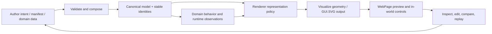

# Diegetic WYSIWYG and Living Documentation

**Status:** architecture direction and acceptance contract. This document describes the next authoring direction; it does not claim that a complete visual editor or universal live-documentation engine exists.
**Owner:** WebPage owns browser-host presentation and the authoring/inspection journey. GUI.SVG, Visualize, Renderer, FSM_COS, FSM_API, and domain packages retain their own responsibilities.
**Branch:** `development`. Do not edit `master`, publish, or deploy.

## The simple philosophy

The Workshop's philosophy is simple: describe what is wanted, compose the capabilities that can provide it, and make the result observable.

The implementation is complex because those responsibilities cross package boundaries, runtime state, data contracts, physical models, rendering backends, and browser presentation. We should not pretend those layers are one thing. We should make their relationships visible and make the common development path easier than hand-building each experience.

**The tool should be part of the world being built.** A creator should be able to inspect and edit a scene, process, route, stage, or Experience in the same context in which it will be experienced. This is the intended meaning of *diegetic WYSIWYG*: the creation interface belongs to the Experience, and its preview is a manifestation of the same underlying model—not a second hand-maintained picture.

## What “living documentation” means here

A visual is living when it has a traceable relationship to the thing it explains. Animation alone does not make it living.

A living visual should identify:

- **Subject:** the model, runtime path, data fixture, algorithm, or architectural relationship depicted.
- **Source:** the exact input data, code path, fixture, or command that produced it.
- **Provenance:** whether it is generated from current code/data, a recorded run, a hand-authored conceptual diagram, or a static fallback.
- **Meaning:** labels, units, coordinate conventions, legends, assumptions, and the interpretation a reader should take away.
- **Evidence boundary:** what it demonstrates and what it does not demonstrate.
- **Reproduction:** a command or test that regenerates it, when generation is supported.
- **Accessibility:** meaningful title/description, readable contrast, text alternative, keyboard-usable controls where interactive, and reduced-motion behavior.

A conceptual SVG is useful when labelled as conceptual. A generated SVG is useful when its inputs and generator are named. Neither should be presented as evidence of a runtime capability that it does not exercise.

## The authoring-to-experience loop

The diagram is a conceptual architecture map, not a trace captured from a running process. Its key invariant is that authoring, execution, and presentation should converge on shared data and stable identity. A preview may be simplified, but it must not silently become a second source of truth.

## Ownership: keep the pipeline honest

| Concern | Owner |
|---|---|
| State transitions and scheduled process behavior | FSM_API |
| Capability dependency closure, arbitration, and RuntimeAssembly | FSM_COS |
| Canonical domain rules, units, identities, and physical observations | Owning domain package |
| Reusable geometry and visualization representation | Visualize |
| Scene submission, observer-relative representation, backend policy and runtime metrics | Renderer, according to its actual API |
| SVG serialization and visual manifestation | GUI.SVG / the actual GUI.SVG adapter contract |
| Browser navigation, authoring journey, inspection UI, and host preview | WebPage |
| Reproducible example inputs, tests, visual snapshots and documentation | The repository that owns the example, with links to upstream contracts |

The file that displays an object does not automatically own its identity, physics, state, or geometry. WebPage should adapt and expose authoritative models, not duplicate domain calculations or grow a parallel renderer.

## Practical progression

### 1. Make current pictures truthful

For every meaningful visual in a README or guide, say what it depicts and link to the relevant source, test, or generator. Mark conceptual, illustrative, fixture-backed, recorded, and runtime-generated output distinctly. Provide static fallback assets only when their status is visible.

### 2. Generate visuals from real inputs

Prefer this chain:

1. A deterministic data fixture or authoritative runtime observation.
2. A named generator or adapter.
3. A generated SVG/other visual artifact.
4. Automated assertions over identities, topology, labels, units, and key plotted values.
5. An embedded image plus a link to the source data, generator, and verification.

Do not replace a real pipeline with manually positioned SVG shapes simply because the result looks convincing. Hand-authored conceptual diagrams remain appropriate for explaining intent and architecture.

### 3. Turn previews into inspection tools

Where the underlying model supports it, let readers select an entity, inspect stable identity and source, toggle representation layers, change the observer/camera, and compare a baseline with a changed input. Display model revision and current evidence state. A control should only be offered when its action is implemented; future controls belong in a roadmap, not as inert decoration.

### 4. Make editing and preview share a model

The WYSIWYG authoring path should validate edits against the same versioned data contract consumed by the runtime. It should distinguish:
- saved model data from transient editor state;
- canonical assets from scene instances and overrides;
- intended gesture/procedure from observed physical outcome;
- authored camera/observer settings from world transforms;
- generated model output from renderer presentation.

The first useful slice is narrow: edit a few fields, validate, preview, save/reload, and prove stable identities and relationships survive. A giant visual editor should emerge from proven slices rather than precede them.

## GUI.SVG and the current WebPage evidence

WebPage already links a [GUI.SVG connected-points sample](../TheSingularityWorkshop/wwwroot/Visualize/07-gui-svg-connected-points.svg), and the Singularity Studios production-plan sample has a source-data → Renderer policy → RendererFrameAdapter → Visualize `GuiSvgVisualizerBackend` path in repository-source mode.

The production-plan sample is a CPU-side SVG manifestation path. It is not proof of a GPU renderer, a general-purpose editor, or a fully live simulation. Its static fallback must remain clearly labelled. See the [Singularity Studios Production Model](SINGULARITY_STUDIOS_PRODUCTION_MODEL.md) and the [Visualize stress campaign](integrations/VisualizeLLM.md) for the current integration boundaries and outstanding evidence.

The City Lab integration remains a separate next seam: a stable, revisioned world snapshot and observer state must feed Renderer representation selection and the adapter/backend path before the host can claim one shared world across its plan, isometric, and street views. Do not imply that the page-local models have already been unified.

## Acceptance checklist

- [ ] Every substantive SVG has a title/description, provenance, and an explicit GUI.SVG usage statement.
- [ ] Every generated artifact links to its fixture/source and reproducible generator or test, where available.
- [ ] Automated tests check important content—not merely that the SVG file exists or is non-empty.
- [ ] Identity, parent relationships, units, transforms, and source revision remain stable across alternate views.
- [ ] Any animated diagram supports reduced motion and remains understandable when motion is unavailable.
- [ ] Interactive controls have real actions, accessible names, and visible state; no pretend buttons.
- [ ] Timing and memory claims are measured with commands, workload, environment, repetitions, and statistics; unavailable GPU metrics are stated as unavailable.
- [ ] The document distinguishes current behavior, active direction, and future work.
- [ ] The README remains a concise invitation and links to this deeper theory instead of becoming a scroll-heavy manual.

## Immediate next work

1. Audit the existing WebPage SVGs and documentation links; classify each as conceptual, fixture-generated, recorded, or runtime-generated.
2. Verify the connected-points and Singularity Studios generation commands in CI and assert meaningful SVG content.
3. Complete the City Lab shared-snapshot → Renderer → Visualize/GUI.SVG seam with identity and coordinate invariants before making stronger “same world” claims.
4. Add authoring controls only after the corresponding data contract, validation, save/reload, and preview behavior are tested.
5. Keep correctness tests deterministic and separate opt-in performance benchmarks from CI.

**North star:** the reader should not merely be told how the Workshop works. They should be able to inspect the model, witness the behavior, trace the evidence, and use the same underlying representation to create something new.

## The every-document requirement

Every document in `docs/` embeds the shared [Living GUI documentation lens](assets/living-gui-documentation-lens.svg) as a consistent navigation cue. That shared illustration does **not** satisfy the subject-specific requirement by itself. Each page must connect its subject to the most useful available living view, deterministic fixture, source file, browser experience, or test. When no such view exists, say so explicitly and record the missing proof as work—not as an implied feature.

The document’s visual should answer: **What am I looking at? What source or fixture drives it? What can I interact with or verify? What does it not prove?** For genuinely live views, expose provenance and refresh/runtime boundaries. For static SVGs and diagrams, label them illustrative. For future designs, label them proposed. A looping animation alone is not evidence that application state is changing.
