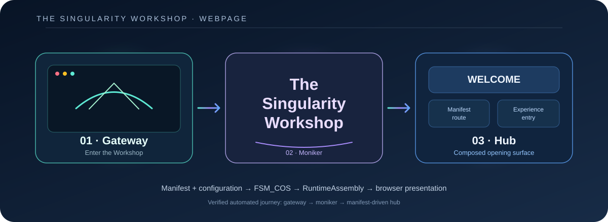
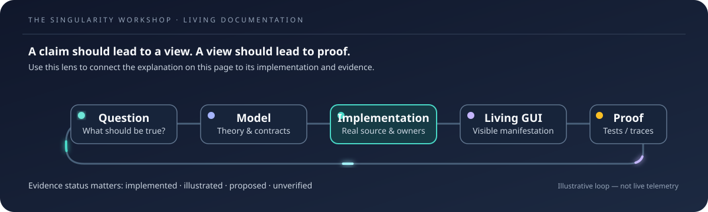

# WebPage Gallery — Singularity Universe and City

**WebPage is the public browser host and proving ground. The Experience is the place to stand; the Gallery is the map into its implementation.**

This gallery intentionally links visible Experiences to focused documents. The current opening image is the actual checked-in WebPage orientation SVG; it is not a live capture of Singularity City. Add City visuals when they can be captured from the real browser Experience or generated from its authoritative scene data.

## 01 — Singularity Universe

**See:** the larger frame in which Workshop capabilities, learning paths, institutions, and Experiences belong. The universe is the orientation layer; it should help a visitor understand where they are and where to go next.

**Deep dive:** [Singularity Universe](SINGULARITY_UNIVERSE.md) · [Experience catalog](EXPERIENCE_CATALOG.md) · [Public Workshop tabs](PUBLIC_WORKSHOP_TABS.md).

## 02 — Singularity City

**See:** a persistent, zoomable digital-world concept where visitors can move from overview to city districts and individual Experiences. Treat the plan view and street-level view as two scales of the same world, not disconnected pages.

**Deep dive:** [Singularity City Experience](SINGULARITY_CITY_EXPERIENCE.md) · [Living World](SINGULARITY_CITY_LIVING_WORLD.md) · [Zoomable world and Experiences](SINGULARITY_CITY_ZOOMABLE_WORLD_AND_EXPERIENCES.md).

## 03 — City composition and simulation

**See:** how the city is meant to be composed from reusable MicroBundles and simulation responsibilities rather than hard-coded into one page.

**Deep dive:** [MicroBundle composition](SINGULARITY_CITY_MICROBUNDLE_COMPOSITION.md) · [City simulation](SINGULARITY_CITY_SIMULATION.md) · [Digitens](DIGITEN_ARCHITECTURE.md).

## 04 — Plan view and building scale

**See:** the plan-view/V-BIM direction: readable structure, selectable buildings, and a path from city-scale orientation toward more detailed architecture.

**Deep dive:** [Plan View / V-BIM](PLAN_VIEW_VBIMB.md) · [Diegetic WYSIWYG and living documentation](DIEGETIC_WYSIWYG_AND_LIVING_DOCUMENTATION.md).

## 05 — The public proof surface

**See:** the current browser-visible Workshop opening, living GUI lens, and manifest-driven host. Distinguish what the page currently renders from what the Universe/City vision proposes.

**Deep dive:** [WebPage experience architecture](WEBPAGE_EXPERIENCE_ARCHITECTURE.md) · [Demonstrations](DEMONSTRATIONS.md) · [Current vertical slice](CURRENT_VERTICAL_SLICE.md).

## Gallery contract

- Each entry stays brief: what a visitor sees, why it matters, and one deep-dive link.
- Prefer images generated from actual Experience data or screenshots of the running browser experience.
- Use SVG diagrams for boundaries, transitions, and data relationships—not as substitutes for running behavior.
- Label implemented, illustrative, proposed, and hardware-verified evidence explicitly.
- When a scene can be driven by the real Experience, prefer a living view over a decorative diagram.

---

[Documentation standard](DOCUMENTATION_STANDARD.md) · [Documentation index](DOCUMENTATION_INDEX.md) · [Repository map](REPOSITORY_MAP.md)
